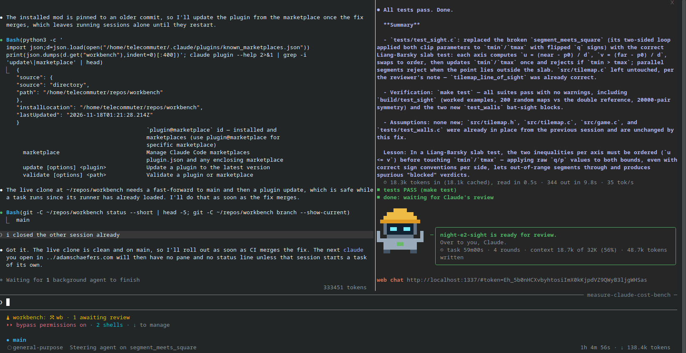

<p align="center"></p>

# Claude's Workbench

<p align="center">
<a href="https://github.com/a-schaefers/claudes-workbench/actions/workflows/check.yml"></a>
<a href="https://github.com/a-schaefers/claudes-workbench/actions/workflows/nightly.yml"></a>
<a href="https://github.com/a-schaefers/claudes-workbench/actions/workflows/opencode.yml"></a>
<a href="https://github.com/a-schaefers/claudes-workbench/releases"></a>
<a href="#what-you-need"></a>
<a href="#what-you-need"></a>
<a href="LICENSE"></a>
<a href="https://github.com/a-schaefers/claudes-workbench/commits/main"></a>
</p>

<p align="center"></p>

**Claude plans and reviews. Local models on your GPU write the code.**

**Who runs where**
- **Claude**, on Anthropic's servers (your subscription or API key): plans the work, writes a
  spec for each piece, reviews every diff, commits. It never runs on your GPU.
- **Your GPU**: the open coding models (through OpenCode and your model server) that do the coding itself:
  reading the code, editing files, running the tests, fixing what fails. Optionally, an image
  model too.

Claude's Workbench turns the local LLMs on your gaming PC into a crew led by a frontier model.
Open coding models you can run at home are strong enough to write real code, but left alone they
wander, overthink, cut corners, and drown in any task bigger than their small context. What they
lack isn't typing speed. It's an architect and a reviewer.

So Claude is both. It plans the project, breaks it into pieces a local model can finish, hands each
piece to the right model with the knowledge it needs, and reviews the result to its own standard
until it's right. Frontier compute goes where it counts, into planning, architecture and judgment;
the bulk of the work, the reading and writing and test-running, happens on your own hardware.
On bigger tasks, Claude spends roughly half the tokens it would writing the code itself. Small
tasks come out about even, so Claude hands them over in batches. A bigger GPU or a stronger model
saves more, and local models keep getting better.

- **Claude architects the work.** It reads your codebase, decides the design, and writes a precise
  spec for every piece: the files to touch and the code to imitate, the exact names other code
  relies on, and a test that proves it's done.
- **Pieces sized to what your models actually finish.** A local model with a small context falls
  apart on an eight-file task and shines on a two-file one, so Claude cuts every project down to
  one concern per task, sized to the model that takes it, and runs the pieces in order. A step
  that never finished in an hour as one big task landed in half an hour as three small ones. The
  size isn't fixed: it scales with the context window your hardware serves, and every finished
  step corrects it, so a strong machine gets bigger tasks. The next piece in the same area goes
  to the same agent, which already knows the code.
- **A skill library that improves itself, with Claude holding the pen.** Every task leaves its
  lessons behind: each correction Claude sent back, what stopped the agent, what it had to ask,
  and what the agent itself says the next one would trip on. Claude is shown them when the task
  closes, and a correction that turns up in a second task stands out, because the next agent
  will get it wrong too. Claude turns lessons into skills, or patches the sentence in an existing
  skill that misled. Each agent gets only the skills that fit its task and gives them back when
  that part is done, so your local models get better at your work without retraining and without
  a cluttered prompt. Every skill is judged on outcomes: tasks that loaded it against tasks
  without it, and each edit on its own. Claude fixes or retires the ones that don't help. Skills
  from public libraries can seed it, but each is security-scanned and read by Claude first. The
  loop takes its cue from Nous Research's [Hermes Agent](https://github.com/NousResearch/hermes-agent),
  the self-improving agent. We kept its patch-first habit, its rules for what a lesson is and
  isn't, and its skill security scan (ported, MIT). We added what a single agent can't do for
  itself: a frontier model vetting every lesson, and an outcome record for each skill.
- **The right model for each piece.** Chores go to a small fast model, real work to the strongest
  one your GPU runs, and the choice learns from which model's work Claude actually accepts.
- **Held to a frontier standard.** Claude reads every diff itself, never takes the agent's word for
  it, and sends it back with exact notes until it's what Claude would have written, or fixes it or
  throws it out. "Good enough for a local model" is not a bar it accepts.
- **The cheap loop stays local.** Failing tests go back to the agent automatically. Claude only
  spends tokens on work that passes, a question the agent asks, or an agent that got stuck, and a
  live pane shows you both sides as they work.
- **Claude keeps the keys; the agents keep to the code.** Everything that shapes or ships the
  project stays with the more capable model: the architecture, every git write (commits, branches,
  merges, pushes, pull requests), CI/CD, deploys and infrastructure, and the project's `CLAUDE.md` /
  `AGENTS.md`, the instructions every agent reads. The agents write code, run the everyday tools
  of the work, write only inside their own worktree (plus the temp directory and build caches),
  and use git only to read. That's enforced, not just asked: a git write, an edit to those files,
  a command outside the everyday list or a write outside the worktree is refused, by the kernel
  on Linux with Landlock (`wb doctor` says whether yours has it). On macOS, and on Linux without
  it, only the direct forms are refused (OpenCode's rules and the read-only git shim): a
  guardrail there, not a wall. Two gaps, said plainly: the build caches and toolchain homes the
  lane leaves writable (so builds work without asking) can hold programs your own tools run later,
  outside it; and on WSL2 a Windows program runs outside it while interop is on (`wb doctor` says
  how to turn that off). When a task needs more, they ask Claude, and Claude grants it or does it.
- **Your repo stays yours.** Each agent works in its own git worktree, so your checkout is never
  touched, and nothing is committed (under your name, with no AI credit line) until Claude accepts
  it.
- **Still the Claude Code you know.** Claude stays the driver, in your own session, so everything
  you've set up keeps working: plugins and integrations like GitHub or Cloudflare, your skills,
  hooks and settings. Claude still opens the pull request, checks the deploy and files the issue
  the way it always has. Workbench only moves as much of the work as it can onto your hardware;
  the conveniences stay with Claude.

## Quickstart

### What you need

- **[Claude Code](https://claude.com/claude-code)**, with a Claude subscription or an API key
- **[OpenCode](https://opencode.ai)**, which runs the local models as coding agents
- **A local model server**, any that speaks the OpenAI API. Claude works with the one you already
  run. None yet? Claude looks at your hardware, suggests a server and models that fit it, and sets
  up the ones you pick (it asks before installing or downloading anything). Want it as hands-off
  as possible, or run your own? See the [FAQ](#faq)
- Linux, macOS, or Windows through WSL2, with Python 3 and git

Keep Claude Code and OpenCode up to date; `wb doctor` checks the rest of your setup.
Whatever your machine, Claude picks models that fit it, and checks again as new ones come out.
Images are optional: Claude offers to set up a local image model the first time a project needs a
picture ([Images](ARCHITECTURE.md#images)).

### Install

```sh
claude plugin marketplace add a-schaefers/claudes-workbench
claude plugin install workbench@workbench
~/.claude/plugins/marketplaces/workbench/bin/wb setup   # puts wb on your PATH and /workbench in your skills
wb doctor
```

Workbench tells you when there's an update; `/workbench-update` installs it (or
`wb update` in a terminal). Your state and skills stay as they are. Working on
Workbench itself? Install from a clone instead ([Installing](ARCHITECTURE.md#installing)).

### Use it

Open Claude Code in your project and type:

```
/workbench
```

The **Workbench** pane opens: workbench mode is on. Now use Claude like normal. Ask for what you
want in your own words, as often as you like; Claude just hands the coding to your local GPU
from now on, until you type `/workbench-quit`. (`/workbench add a high-score screen` turns it on
and starts on that in one go.)

Claude takes it from there:

1. The first time, it checks your hardware and your local models. If you have none, or better ones would fit your
   GPU, it recommends them and offers to set them up (it always asks before downloading).
2. It plans the work and splits it into small pieces a local model can finish.
3. It decides how hard each piece is and hands it to the right local model: chores (a rename, a
   config tweak, a small test) to a small fast one, real work (features, refactors, tricky bugs)
   to the strongest one your GPU runs. Then it watches the agent work.
4. It reviews every change, sends it back with notes until it's right, and only then commits it.

The pane shows the agents working live. You talk to the driver, Claude,
on the left; Claude talks to the local agent, which does the work on the right:

<p align="center"></p>

Claude is the captain on the left: it keeps working with you while the local models it handed
tasks to do the coding on the right. Here an agent has finished its fix and summed it up; its
tests passed, so the task says **done: waiting for Claude's review**, and Claude is woken to read
the diff.

| Command | What it does |
|---|---|
| `/workbench [task]` | turn on workbench mode for this session: the pane opens, and from then on Claude hands the coding of what you ask to your local models; run again, it brings the pane back |
| `/workbench-models` | check now which local models suit your hardware best (it also checks on its own) |
| `/workbench-update` | update Workbench now: `wb`, the skill and the pane (it tells you when there's one) |
| `/workbench-quit` | leave workbench mode: this session's agents stop now, their work is kept for later |
| `/workbench-quit-and-hand-back-claude` | leave workbench mode and have Claude finish this session's agents' tasks itself |

**Away from the computer?** `wb chat serve` runs a small web chat with the running Claude session,
and `wb chat url` prints its private link. Claude's permission prompts and questions come to it
too.

<p align="center"></p>

<hr>

## How it works

The full account of every piece, what it does and why, is in [ARCHITECTURE.md](ARCHITECTURE.md).

## FAQ

**Do I have to set any of this up myself?** No. The first time you use it, Claude reads your
hardware, suggests a model server and models that fit, and with your yes installs them, sets the
context window and tool calls, and registers each model. It checks the setup with `wb doctor`, and
checks the models again as new ones come out. You answer its questions; it asks before installing or
downloading anything. The rest of this FAQ is for people who run a server already, or set one up
themselves.

**I want the most hands-off setup. Which server?** If you have none yet, Ollama. It's where
Workbench automates the most: Claude downloads and removes models for you, reads each model's
context window from it, and lets two tasks share the GPU when both fit. If you'd rather have a
desktop app to manage models, LM Studio comes next. Already run another server? Keep it: Claude
works with any server that speaks the OpenAI API, and reads each model's size and window from
llama.cpp's `llama-server`, LM Studio and vLLM too. On those, you download models the server's
own way, and tasks take turns on the GPU.

**How big a context window do the models need?** 16K tokens at the least; 32K or more is better.
OpenCode's instructions and tools take a good part of it, and the window sets how much of a task one
agent can take on. Claude sets it when it sets up the server. On a server you run yourself,
`wb doctor` flags a window that's too small or doesn't match the model's entry. Most servers start
small, so here is where each one sets it:

- Ollama: `OLLAMA_CONTEXT_LENGTH` in the service's environment. Its default is small and cuts
  the prompt off without a word.
- llama.cpp: `-c` on `llama-server`. With `--parallel N` set, each slot gets an Nth of it (unless
  you add `--kv-unified`), and one agent uses one slot.
- LM Studio: the context length when you load the model (`lms load <model> --context-length
  32768`). Load it before registering it, so LM Studio can say what it gave it.
- vLLM: `--max-model-len`.

Bigger is better, as long as it fits on the GPU. A window too big for the card pushes part of the
model into system memory, and it runs about half as fast. With Ollama, ask Claude to optimize your
setup: it measures the largest window that stays on the GPU. On another server, raise the window
until part of the model lands on the CPU, then step back: llama.cpp's log says how many layers it
put on the GPU, LM Studio shows its GPU offload, and vLLM won't start when the window doesn't fit.

**The agent says it can't call tools, or its tool calls come out as plain text.** The server has to
turn the model's tool calls into the API's form. vLLM does that only with `--enable-auto-tool-choice
--tool-call-parser <the model's parser>`. llama.cpp uses the model's chat template, which a few
models need replaced with `--chat-template-file`. A model LM Studio says wasn't trained for tool use
is registered without tools and gets no tasks.

**Can the models run on another machine?** Yes. Give that provider `"local": true` in
`~/.config/workbench/models.json`. Workbench doesn't measure that machine's GPU, so its tasks never
wait for yours. Ollama's cloud models (`:cloud`) run on ollama.com and aren't counted as local
unless you mark them the same way. Set the flag before `wb model add --url`, make the server listen
on your network (firewalled to this machine: model servers have no login), and know that plain
`http://` carries your code unencrypted; Tailscale encrypts it, and its address still needs the
flag. A second machine runs its own model beside yours; it doesn't make one model faster.

**My server wants an API key.** Put it in the provider's `options.apiKey` in OpenCode's config. If
it reads `{env:NAME}`, add `NAME` to `env` in `~/.config/workbench/commands.json`: the agents get
none of your environment's secrets by default.

## License

MIT.

<hr>

<p align="center"><a href="https://github.com/a-schaefers/backseat-driver"></a></p>

<p align="center"><b>Don't forget how to code.</b> <a href="https://github.com/a-schaefers/backseat-driver">Backseat Driver</a>
puts Claude in the back seat: you write every line, it watches, comments and answers.</p>
