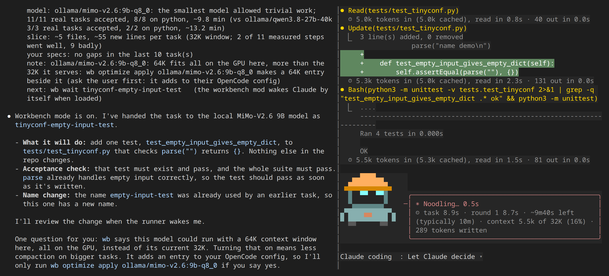

<p align="center"></p>

# Claude's Workbench

**Claude orchestrates. An OpenCode local LLM on your GPU writes the code.** Workbench is a
Claude Code plugin that connects the two inside your normal Claude Code session.

<p align="center">
<a href="https://github.com/a-schaefers/claudes-workbench/actions/workflows/check.yml"></a>
<a href="https://github.com/a-schaefers/claudes-workbench/actions/workflows/nightly.yml"></a>
<a href="https://github.com/a-schaefers/claudes-workbench/actions/workflows/opencode.yml"></a>
<a href="https://github.com/a-schaefers/claudes-workbench/releases"></a>
<a href="#what-you-need"></a>
<a href="#what-you-need"></a>
<a href="LICENSE"></a>
<a href="https://github.com/a-schaefers/claudes-workbench/commits/main"></a>
</p>

- **Claude is the lead, your local models are the crew:** Claude assigns each step to a model
  sized for it, reviews what comes back, and returns it until it's right.
- **Agents get Claude's know-how:** a library of skills Claude keeps and grows, handed out per
  task ([the skill library](ARCHITECTURE.md#the-skill-library)).
- **It's still just Claude Code.** You talk to Claude as usual, your plugins, skills and settings
  keep working, and the agents work on their own branches, so your checkout is untouched until
  you accept.
- **Beyond code: images and audio.** Optionally, Claude directs local image and audio models
  too, making a project's icons, illustrations, voice lines, sound effects and music. It looks at
  every image; it can't hear, so each sound comes with a transcript and measurements it can read,
  and for music you have the last word ([images](ARCHITECTURE.md#images),
  [audio](ARCHITECTURE.md#audio)).
- **See how it's going: the Stats tab.** The Workbench pane's Stats tab shows this machine live:
  each GPU's memory, load and watts, the running task's speed, and every model, loaded or not.
  Below that is your history: tasks landed, Claude tokens saved (an estimate), energy and its
  cost, streaks and bests, what the agents fixed without waking Claude, each model's speed over
  time, and what tends to stop them. It all stays on your machine and costs nothing while the tab
  isn't on screen.
- **Experimental: lighter code reading.** Turn on *Agent code navigation* in the pane's Settings
  and agents read a file's outline and just the function they need, instead of the whole file,
  which saves their context on big files. It needs [probe's release
  binary](https://github.com/probelabs/probe/releases) on your PATH, which you install yourself
  (crates.io's `probe-code` lacks the command it uses); without it the setting changes nothing,
  and the pane says so. It's off by default and may go away
  ([experiments](ARCHITECTURE.md#experiments)).
- **Optional: Claude on your phone.** Off by default. Turn on *Web chat* in the pane's Settings
  and a small web app, served on localhost, becomes another lane to the same Claude session in
  your terminal: message Claude, answer its questions and permission prompts. Reach it over your
  own network, such as Tailscale (`tailscale serve` gives it an https address), and it installs
  on your phone as an app that notifies you when Claude answers or needs you. It does less than
  the Claude app with Remote Control (`claude rc`); it's a simple alternative that talks to the
  workbench plugin in your session directly ([the web chat](ARCHITECTURE.md#the-web-chat)).

On bigger coding tasks, once the session is already open, handing the coding off to the local
model typically costs Claude about half the tokens of writing the code itself
([how we measured it](THESIS.md)).

## Quickstart

### What you need

- [Claude Code](https://claude.com/claude-code), with a Claude subscription or an API key
- [OpenCode](https://opencode.ai) 2.3 or newer
- Git and Python 3.11 or newer, on Linux, macOS, or Windows through WSL2
- A local model. **Already run a server** that speaks the OpenAI API? Claude uses it (tool calls
  and a 32K context window recommended, 16K at the least). **None yet?** Claude suggests one that fits your hardware and
  asks before installing or downloading anything.
- (optional) An image or audio model, for pictures and sound. The first time a project needs one,
  Claude proposes a model that fits your machine and your use's licence, and asks before
  downloading it. Small speech models run on the CPU; music wants a GPU.

Tested in the Claude Code CLI only, not the Claude desktop app.

### In your terminal

```sh
claude plugin marketplace add a-schaefers/claudes-workbench
claude plugin install workbench@workbench
"${CLAUDE_CONFIG_DIR:-$HOME/.claude}"/plugins/marketplaces/workbench/bin/wb setup   # puts wb on your PATH and /workbench in your skills
```

### In Claude Code, inside your project

```
/workbench
```

The first time, Claude finishes the setup and proves it on a tiny sample task.

Then work as you always do. On the left is Claude, as usual; on the right, the local agents it's
directing for you.

<p align="center"></p>

`/workbench-quit` stops the agents and keeps their work for later.
`/workbench-quit-and-hand-back-claude` has Claude finish their tasks itself.
`/workbench-update` installs the latest workbench (Claude Code tells you when there's one).

## License

MIT.
