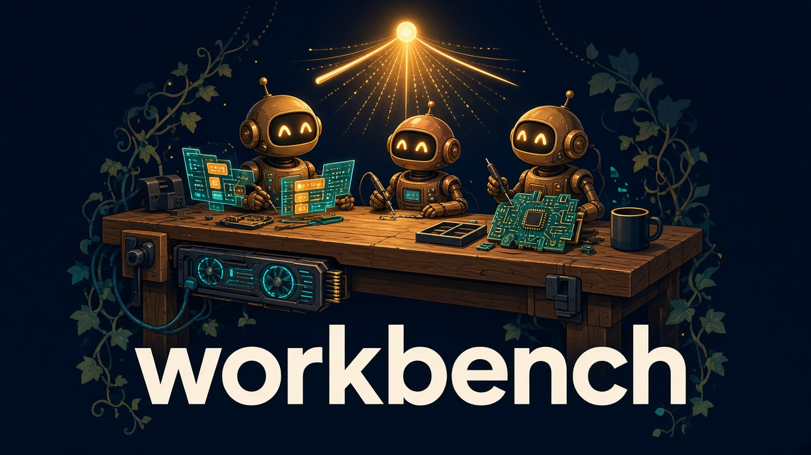
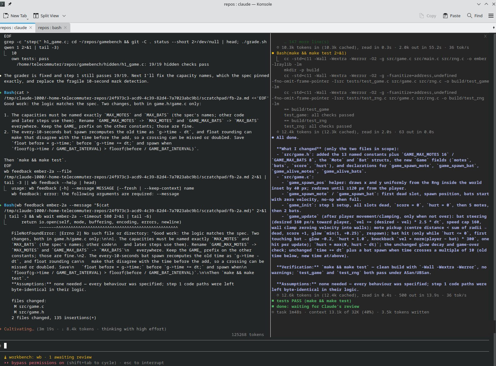

<p align="center"></p>

# Claude's Workbench

<p align="center"></p>

**Frontier judgment, local horsepower. Claude leads; your GPU does the heavy lifting.**

Claude's Workbench turns the local LLMs on your gaming PC into a crew led by a frontier model.
Open coding models you can run at home are strong enough to write real code, but left alone they
wander, overthink, cut corners, and drown in any task bigger than their small context. What they
lack isn't typing speed. It's an architect and a reviewer.

So Claude is both. It plans the project, breaks it into pieces a local model can finish, hands each
piece to the right model with the knowledge it needs, and reviews the result to its own standard
until it's right. Frontier compute goes where it counts, into planning, architecture and judgment;
the bulk of the tokens, the reading and writing and test-running, happen on your own hardware.

- **Claude architects the work.** It reads your codebase, decides the design, and writes a precise
  spec for every piece: the files to touch and the code to imitate, the exact names other code
  relies on, and a test that proves it's done.
- **Pieces sized to what your models actually finish.** A local model in a 32K context falls
  apart on an eight-file task and shines on a two-file one, so Claude cuts every project down to
  one concern per task, sized to the model that takes it, and runs the pieces in order. A step
  that never finished in an hour as one big task landed in half an hour as three small ones. The
  size isn't fixed: it scales with the context window your hardware serves (about two or three
  files and 150 lines on 32K, more on a bigger one), and every finished step corrects it, so a
  strong machine gets bigger tasks. The next piece in the same area goes to the same agent, which
  already knows the code.
- **A skill library that improves itself, with Claude holding the pen.** Every task leaves its
  lessons behind: each correction Claude sent back, what stopped the agent, what it had to ask,
  and what the agent itself says the next one would trip on. Claude is shown them when the task
  closes, and a correction that turns up in a second task stands out, because the next agent
  will get it wrong too. Claude turns lessons into skills, or patches the sentence in an existing
  skill that misled. Each agent gets only the skills that fit its task and gives them back when
  that part is done, so your local models get better at your work without retraining and without
  a cluttered prompt. Every skill is judged on outcomes: tasks that loaded it against tasks
  without it, and each edit on its own. Claude fixes or retires the ones that don't help. Skills
  from public libraries can seed it, but each is security-scanned and read by Claude first. The
  loop takes its cue from Nous Research's [Hermes Agent](https://github.com/NousResearch/hermes-agent),
  the self-improving agent. We kept its patch-first habit, its rules for what a lesson is and
  isn't, and its skill security scan (ported, MIT). We added what a single agent can't do for
  itself: a frontier model vetting every lesson, and an outcome record for each skill.
- **The right model for each piece.** Chores go to a small fast model, real work to the strongest
  one your GPU runs, and the choice learns from which model's work Claude actually accepts.
- **Held to a frontier standard.** Claude reads every diff itself, never takes the agent's word for
  it, and sends it back with exact notes until it's what Claude would have written, or fixes it or
  throws it out. "Good enough for a local model" is not a bar it accepts.
- **The cheap loop stays local.** Failing tests go back to the agent automatically. Claude only
  spends tokens on work that passes, a question the agent asks, or an agent that got stuck, and a
  live pane shows you both sides as they work.
- **Claude keeps the keys; the agents keep to the code.** Everything that shapes or ships the
  project stays with the more capable model: the architecture, every git write (commits, branches,
  merges, pushes, pull requests), CI/CD, deploys and infrastructure, and the project's `CLAUDE.md` /
  `AGENTS.md`, the instructions every agent reads. The agents write code and use git only to read,
  and that's enforced, not just asked: a git write or an edit to those files is refused. When a
  task needs more, they ask Claude, and Claude does it.
- **Your repo stays yours.** Each agent works in its own git worktree, so your checkout is never
  touched, and nothing is committed (under your name, with no AI credit line) until Claude accepts
  it.
- **Still the Claude Code you know.** Claude stays the driver, in your own session, so everything
  you've set up keeps working: plugins and integrations like GitHub or Cloudflare, your skills,
  hooks and settings. Claude still opens the pull request, checks the deploy and files the issue
  the way it always has. Workbench only moves as much of the work as it can onto your hardware;
  the conveniences stay with Claude.

The payoff is a smaller Claude bill for the same quality bar: a cheaper subscription, or one day
just the API for the lead and local models for everything else. How much you save depends on how
much you use it and what your electricity costs (a busy GPU isn't free). But it's a fun project,
and it works.

## Quickstart

### What you need

- **[Claude Code](https://claude.com/claude-code)** with a Claude subscription or an API key
- **[OpenCode](https://opencode.ai)**, which runs the local models as coding agents
- **A local model server**, usually [Ollama](https://ollama.com). No models yet? That's fine: the
  first time you use it, Claude looks at your hardware, recommends the best models it can run, and
  sets them up in OpenCode (it asks before downloading anything)
- Linux, macOS, or Windows through WSL2 (native Windows lacks the POSIX file locks and signals
  `wb` uses), with Python 3.11+ and git, which `wb` itself runs on
- **Optional, for images:** a local image tool and model ([Images](#images)). Claude offers to set
  one up the first time a project needs a picture, and asks before installing or downloading
  anything

Whatever your machine, Claude picks models that fit it, and checks again every week as new ones
come out.

### Install

```sh
git clone https://github.com/a-schaefers/claudes-workbench ~/repos/workbench
# to upgrade later: git -C ~/repos/workbench pull, then restart Claude Code (or /reload-plugins);
# the links and the plugin read from the clone, and your state and skills stay as they are
cd ~/repos/workbench
mkdir -p ~/.local/bin ~/.claude/skills   # ~/.local/bin must be on your PATH
ln -s "$PWD/bin/wb" ~/.local/bin/wb
ln -s "$PWD/skill/delegate" ~/.claude/skills/delegate
claude plugin marketplace add "$PWD"
claude plugin install workbench@workbench
wb doctor
```

### Use it

Open Claude Code in your project and type:

```
/delegate
```

The **Workbench** pane opens: delegate mode is on. Now use Claude like normal. Ask for what you
want in your own words, as often as you like; Claude just hands the coding to your local GPU
from now on, until you type `/delegate-quit`. (`/delegate add a high-score screen` turns it on
and starts on that in one go.)

Claude takes it from there:

1. The first time, it checks your hardware and your local models. If you have none, or better ones would fit your
   GPU, it recommends them and offers to set them up (it always asks before downloading).
2. It plans the work and splits it into small pieces a local model can finish.
3. It decides how hard each piece is and hands it to the right local model: chores (a rename, a
   config tweak, a small test) to a small fast model like MiMo 9B, real work (features,
   refactors, tricky bugs) to the strongest model your GPU runs, like Qwen 27B. Then it watches
   the agent work.
4. It reviews every change, sends it back with notes until it's right, and only then commits it.

The pane shows the agents working live. You talk to the driver, Claude,
on the left; Claude talks to the local agent, which does the work on the right:

<p align="center"></p>

Here Claude (left) has just sent the agent review feedback on a game step: two exact changes, and
why. On the right the agent made them, built the game, ran the tests, and summed up its work;
the tests passed, so the task now says **done: waiting for Claude's review**, and Claude is woken
to read the diff.

| Command | What it does |
|---|---|
| `/delegate [task]` | turn on delegate mode for this session: the pane opens, and from then on Claude hands the coding of what you ask to your local models |
| `/workbench` | open the pane: every delegated task, and the agent's work live |
| `/delegate-models` | check now which local models suit your hardware best (it also happens weekly) |
| `/delegate-quit` | leave delegate mode: every agent stops now, their work is kept for later |
| `/delegate-quit-and-hand-back-claude` | leave delegate mode and have Claude finish the agents' tasks itself |

**Away from the computer?** `wb chat serve` runs a small web chat with the running Claude session,
and `wb chat url` prints its private link (on Linux, `systemctl --user link
"$PWD/systemd/wb-chat.service" && systemctl --user enable --now wb-chat`, run in the clone, keeps
it running, and `systemctl --user restart wb-chat` after an upgrade; on macOS, a launchd agent running `~/.local/bin/wb chat serve` does). It's `http://localhost:1337`; to use it from your phone, reach your PC the way you
normally do and change the host in the link. It serves only localhost until you say otherwise in
`~/.config/workbench/chat.json`: `{"bind": ["localhost", "tailscale"]}` adds this machine's
Tailscale address, `{"bind": ["0.0.0.0"]}` every interface (your LAN, a VPN), and
`"hosts": ["chat.example.org"]` a name a tunnel or proxy sends (`"*"` for any).

<p align="center"></p>

**Watching from a terminal?** `wb watch` follows the newest task live, and `wb status` lists the
open ones.

## What we found (November 2026)

workbench is developed and tested on one ordinary gaming PC: **Ryzen 5 7600X · Radeon RX 9070 XT
(16 GB) · 32 GB DDR5 · Arch Linux.** On that machine:

- **Qwen 27B** (Ollama, Q3) does the real work: it fits entirely on a 16 GB card and passed nearly
  every task we gave it. **MiMo 9B** takes the trivial chores.
- Bigger models squeezed onto the card with system RAM were slower, crashed, and were no better.
- Quantization matters (higher is better), but on 16 GB a larger model at about 4 bits beats a
  smaller one at 8.
- Thinking mode off works best for agent work: the model writes code instead of planning it at
  length.

Models change fast. Once a week workbench asks Claude to check what's new for your hardware and
recommend changes; nothing is downloaded without your yes.

<hr>

## How it works

This part is the full picture: every piece, what it does, and why it's built that way.
Development notes for contributors (and for Claude) are in [CLAUDE.md](CLAUDE.md).

### The pieces

```
 you ─▶ Claude Code ─────────────────────────────────────────────────────────────┐
         │ /delegate skill: plan, spec, review          workbench mod: pane,     │
         │ (skill/delegate/SKILL.md)                    status line, wake-ups,   │
         ▼                                              web chat, compaction     │
        wb ──────── writes ────▶  ~/.local/state/workbench/  ◀── watches (wb events)
         │ spawns                   tasks/<name>/…  notify.jsonl  results.jsonl  chat/
         ▼                                 ▲
      runner (detached, one per task) ─────┤ writes status, events, reports, notices
         │ GPU lock, loads the model       │
         ▼                                 │
      opencode run  in tasks/<name>/worktree (branch delegate/<name>)
         │      └─ ask_reviewer (MCP server) ─ writes the question, blocks for the answer
         ▼
      local model server (Ollama, or any OpenAI-compatible server on this machine)
```

- **`/delegate`** (`skill/delegate/SKILL.md`) turns delegate mode on for the session and is
  Claude's procedure in it: size the work, write the spec, dispatch, drive, review, accept. You
  type it once, then ask for things as usual; the mod keeps the mode (and reminds Claude of it
  after a compaction or `/clear`) until a quit command. Only you turn it on; Claude never
  delegates on its own.
- **`wb`** is the CLI Claude drives. Every command does one thing and prints a short, plain
  report, because Claude reads it and Claude's tokens are the scarce resource.
- **The runner** is a detached process per task. It drives the agent round after round until the
  task needs Claude, then exits. Nothing has to stay open for a task to run.
- **OpenCode** runs the local model as a coding agent, headless, in the task's own git worktree.
- **The workbench mod** is a Claude Code plugin. It draws the pane, keeps a status line, and starts
  a turn for Claude the moment a task needs it, so Claude never polls.
- **The web chat** is a small page and server for reaching the same Claude session from a phone.

Everything talks through plain files in one state directory. The CLI, the runner, the agent's
`ask_reviewer` tool, the mod and the web chat never call each other; they read and write the same
files, and anything that waits sleeps in the kernel (inotify on directories, pidfd on processes)
until one of them changes. A crashed piece loses nothing, and every piece can be inspected with
`cat`.

workbench is Python's standard library only, plus the TypeScript mod. No model is named anywhere
in the code: models come from OpenCode's config and the router decides, so a new model is one
config entry away.

### A task, start to finish

```
 wb start ─▶ queued ─▶ running ─▶ testing ──pass──▶ review ─▶ wb accept ─▶ accepted
               ▲  (GPU)    │  ▲         │                 │
               │           │  └─ fail: auto-fix round     ├─ wb feedback / wb next ─▶ queued
               │           │     (up to --auto-fix)       └─ wb discard ─▶ discarded
               │           ├─▶ asking: ask_reviewer, blocked until wb answer
               │           └─▶ stuck / failed ─▶ wb feedback ─▶ queued, or wb discard
               └── a steer note or an interrupt continues the same session
```

**1. Claude writes a spec.** The skill tells Claude to size every task to what the model that
takes it actually finishes: one concern, no bigger than that model's slice, with the files
named, the code to imitate pointed at, exact names for anything other code relies on, and an
acceptance command that proves it's done (an existing test, or a new one the agent writes first).
Bigger work is split into steps run one after another. Planning, in Claude Code's plan mode or not,
works the same way: in delegate mode the plan you approve is already that list of steps, each with
its size, files, exact interfaces and acceptance command, and what stays Claude's (git, CLAUDE.md,
your decisions, the review checks) marked apart.

**2. `wb start` sets it up** and returns at once:
- It checks the task name, that the repo is a git repo, and that it has a committed `CLAUDE.md`
  (an agent without one starts blind; `--no-claude-md` is for throwaway repos).
- It picks the model: the router's choice for the task's size (`--size trivial|significant`)
  and the repo's stack (its main languages, from its tracked files), or `--model`. A model that can't run right now (server down, not pulled) is refused unless
  `--force`.
- It makes branch `delegate/<task>` in a fresh git worktree from `--base` (default `HEAD`). Your
  own checkout is never touched, and uncommitted changes in it stay out of the agent's copy (it
  says so).
- It writes round 1's prompt: the spec plus a short working protocol (stay in scope, leave changes
  uncommitted, run the acceptance command, the `ask_reviewer` budget, how to finish).
- It records the task (`task.json`), spawns the runner, and prints what it did and why it chose
  that model.

**3. The runner takes the GPU.** Tasks run side by side when their models fit the GPU together:
on a big card, several GPUs or Apple's unified memory, a second task's model loads beside the
first and both work at once. The test is memory: the models' sizes (Ollama's own figure once
loaded, weights and context; before that the weights plus a quarter, or `vram_gb` in
models.json) must fit 90% of the GPU's memory (`wb scout` reads it; on Apple Silicon, what macOS
lets the GPU wire). Only Ollama models share; the same model twice needs `OLLAMA_NUM_PARALLEL`
of 2 or more. Otherwise, or when the machine can't say its VRAM, the task waits as `queued` for
the GPU to itself, first come first served. A runner holds `gpu.lock` shared while it shares and
exclusively when alone, so anything that needs the whole GPU (`wb image`) waits for the running
tasks and holds new ones off. The runner then makes the task's model resident: it unloads every
other model Ollama holds (yours or another tool's) except those of tasks running beside it, stops
other model servers that have a stop command (waiting up to ten minutes for a reply in progress
to finish), and loads or starts the one it needs.

**4. The agent works a round.** The runner runs
`opencode run --standalone --auto --format json` in the worktree, with `$PWD` set to it (OpenCode
finds the project from `$PWD`) and a per-task config layer (`OPENCODE_CONFIG`, below). Rounds after
the first continue the same OpenCode session, so the agent keeps what it has read. Every event
streams into `events.jsonl` (tool calls, messages, token counts, errors) and `status.json` keeps
the live summary: phase, round, the last action, tools used, tokens in and out.

**5. Guards stop a run that's going nowhere.** Small models that lose the thread repeat
themselves, so the runner stops the agent on:

| Guard | Default |
|---|---|
| the same tool call (same input) several times in a row | 4 |
| failing tool calls in a row | 6 |
| tool calls without changing a file | 40 |
| no output at all (not counted while it waits on Claude) | 15 min (`--silence-timeout`) |
| one round running too long | 40 min (`--round-timeout`) |

A model generating for minutes with no tool call is usually planning instead of doing. Past the
think budget (7 minutes, `--think-timeout`; 0 turns it off) the runner interrupts it once a round
with a nudge (act now: the smallest edit first, one file per call, run the tests soon) and tells
Claude.

These limits were set on a 27B model that writes ~36 tokens a second. A slower machine gets
longer ones, learned per model: after every round the runner reads from the session how fast the
model wrote (output and reasoning tokens after the first) and read (new input before the first
token), keeps the recent samples in `speed.json`, and `wb start` gives the think budget the time
~13.5K tokens of thinking plus a full window of reading take at those speeds, scaling the silence
and round limits with it. None goes below its default; `wb models` shows each model's speeds.

**6. The tests gate the round.** After a clean round the runner runs the acceptance command
(`--test`) in the worktree, with a 15-minute limit and the output saved per round. If it fails and
auto-fix rounds remain (`--auto-fix`, default 2), the failure output goes straight back to the
agent as the next round's prompt ("fix the code, don't weaken the tests"), and Claude isn't woken.

**7. Claude is woken with a report.** When the round passes (or auto-fix runs out), the runner
writes a compact report and a notification and exits. The report has the round's time and local
tokens, how full the agent's context is, the test result (the failing tail if any), the tool
tally and errors, the agent's own summary, and the files changed with a diffstat. Stuck and failed
rounds get the same report, with why it stopped.

**8. Claude reviews.** The skill is strict about this: the summary is a claim, not evidence.
Claude reads the whole diff (`wb diff`), checks correctness, the spec, that the tests would catch a
bug, the repo's conventions, hygiene and safety, and runs things in the worktree when in doubt.
Then one of:

| Command | What happens |
|---|---|
| `wb accept <task> -m "…"` | commits the work on its branch, removes the worktree, optionally `--merge`s (`--no-ff`, only into a clean checkout) |
| `wb feedback <task> --message <file>` / `--text "…"` | a numbered list of exact changes becomes the next round's prompt; the runner starts again. The skill allows three review rounds before Claude fixes it itself or discards it |
| `wb next <task> --spec <file> -m "…"` | commits the approved step on the branch and gives the next step to the same agent, in the same worktree and session |
| `wb discard <task> --reason "…"` | stops it, removes the worktree and the branch (`--keep-branch` keeps it) |

Every accepted or discarded task leaves a row in `results.jsonl`: the model, the size, the repo and its stack, rounds,
auto-fixes, reviews, minutes, local tokens, the skills it was offered and loaded, the outcome. The
router learns from those rows. A check of workbench itself on a scratch repo isn't evidence of
how a model does real work: `wb start --trial` marks it (its row is kept but left out, and its
lessons aren't gathered), and `wb trial <task>…` marks a closed one after the fact.

### What the agent knows

An agent should start a task knowing what Claude would know in the same repo, and nothing that
would distract it. The per-task OpenCode config layer (`tasks/<name>/opencode.json`, written
before every round) gives it:

- **Instructions**, as absolute paths OpenCode loads into the system prompt:
  - the workbench handbook (`agent/HANDBOOK.md`, copied into the task directory so its path never
    points the agent outside its worktree): read before editing, imitate the codebase, smallest
    diff, never weaken a test, change approach after two failures, stay in the working directory,
    leave every git write and deploy to Claude, and an honest final summary;
  - your own `~/.claude/CLAUDE.md`, and the repo's `CLAUDE.md`, `.claude/CLAUDE.md`,
    `CLAUDE.local.md` and `.claude/rules/*.md` (the worktree's copy when committed, the repo's when
    local). OpenCode reads `AGENTS.md` itself but never `CLAUDE.md`; a `CLAUDE.md` with the same
    contents as `AGENTS.md` is skipped so nothing is loaded twice;
  - a short map of nested `CLAUDE.md`/`AGENTS.md` files in subdirectories, to read before working
    there, instead of loading them all.
- **Denied tools**, which also leave the prompt (it shrinks from about 9K to 3.5K tokens, which a
  local model reads on every request): `question` (nobody answers it headless), code mode and the
  `opencode_*` tools (they can move the session or remove worktrees), `subagent` (a second model
  would queue behind the GPU lock), web search and image generation.
- **Hard limits**, checked in every part of a compound command: no `sudo`, `doas`, `pkexec` or
  `su`; no `gh`; and git is read-only (below). No edits to `CLAUDE.md`, `CLAUDE.local.md`,
  `AGENTS.md` or anything under `.claude/`: those are Claude's.
- **Commands.** The agent's shell runs the everyday tools of software work without asking: files
  and text, builds and compilers, test runners, interpreters, and package managers installing what
  the project already lists. Anything else (network tools, system services, a new package) is
  refused, and the agent asks Claude through `ask_reviewer`; Claude grants it with `wb allow
  <task> "<pattern>"`, for the task or `--always`, and the agent carries on within seconds. Your
  standing allowances live in `~/.config/workbench/commands.json` (`{"allow": ["curl *"]}`;
  `["*"]` turns the list off). It's a guardrail on the agent's own choices rather than a sandbox
  (make and any interpreter can run anything); the hard limits stay hard: no sudo, git
  read-only, no `gh`.
- **Skills**: the repo's own `.claude/skills`, plus the library skills Claude handed this task.
  Your personal `~/.claude/skills` (including synced Claude app skills) and `/delegate` itself are
  denied: an agent once read a personal skill as a "newer task" and went off into your files.
- **`ask_reviewer`**, an MCP tool for one blocking question to Claude (below).

### Talking to a running agent

Claude is the driver, not a spectator, and the agent is a teammate it can reach at any time:

- **Questions.** `ask_reviewer` is a tiny MCP server (`workbench/ask_mcp.py`) OpenCode starts per
  task. A call writes the question to the task directory, sets the phase to `asking`, raises a
  `question` notification and blocks until `wb answer` writes the answer file, or 20 minutes pass
  (`--ask-timeout`). Each task has a budget (`--ask-budget`, default 2); past it, or on timeout, the
  agent is told to make the reasonable choice and say so. The silence guard doesn't count the wait.
- **Notes.** `wb steer <task> --text "…"` queues a note the agent gets when its current run ends,
  before the tests. `--now` interrupts it mid-step: the runner is woken by the note itself, stops
  the agent within seconds and continues the same session with the note first, marked as
  overriding anything earlier.
- **Check-ins.** A significant task wakes Claude every 10 minutes while it runs (`--checkin MIN`, 0
  for off; off by default for trivial tasks) with a digest of what changed since the last one:
  tools used and failed, tokens read and written, what it's doing now, its latest words, files
  changed, time so far and the ETA. Claude tells you how it's going in two or three lines, logs the
  same with `wb note` (a "captain's log" line in the transcript), and steers if it's drifting.
- **Taking over.** `wb takeover <task>` stops the agent and hands the worktree to Claude, to finish
  by hand and accept, or hand back with `wb feedback`. `wb stop <task>` just stops it.

### Context, on both sides

Local models work in a small context window, and so, in its own way, does Claude.

**The agent's.** Rounds continue one OpenCode session. The runner reads the context every step
reports: once it's past the handover point (60% of the window until evidence says otherwise:
see *Self-tuning* below), it stops the agent, mid-round if need be, and a fresh session takes
over, handed exactly what it needs: the task (the current step's spec), the steps already
committed, the uncommitted diff (or the list of changed files when the diff is over 9% of the
window, about 3K tokens on 32K), the agent's last words and the new instructions. OpenCode's own
compaction is a small model's summary of its session, which drops details and can lose the task
itself (seen: an agent that built CLAUDE.md's "next step" after one), so the task's config sets it
only as a backstop just past that point: room for one reply at the model's output cap and one
step's growth. A session OpenCode compacted anyway is replaced at the next round too.
Reports show the fill (`agent context: 19.4K of 32K (60%)`) so Claude sees it coming.
`wb feedback --fresh` forces a fresh session (a confused agent), `--keep-context` keeps it for one
more round.

**The slice.** How much one task should hold on a model is learned like the router's choice. The
first guess scales with the window it is served: two or three files and about 150 new lines on
32K (what was measured), proportionally more on a bigger window, up to four times that. Each step
that closes (`wb next`, `accept`, `discard`) records its files and added lines, and how it went:
badly when a session was compacted, the agent got stuck, or it needed two review rounds the agent
caused (a round marked `--spec-gap` is Claude's, not the agent's); well when it landed short of
that. A handover to a fresh session is counted but not held against the step: it is how the
runner gets through a big one, and its cost shows in the task's time. Check-ins and reports also name changed files the spec never mentions (`NOTE: the spec
doesn't name src/flow.c`), where an agent's drift shows first. The biggest step that went well
raises the slice past the guess; the smallest that went badly lowers it. `wb models`, `wb start` and `wb scout` show it (`slice: ~3 files, ~150 new lines per task (32K
window; 4 of 5 measured steps went well, 1 badly)`). The window itself comes from what
Ollama serves the model (the loaded model, its Modelfile's `num_ctx`, or `OLLAMA_CONTEXT_LENGTH`);
`wb model add` writes that, with an output budget of an eighth of it, and `wb doctor` flags an entry
that claims more than Ollama serves (prompts would be cut off) or less (tasks could be bigger). A session stays bound to the directory it was made in, so context carries over only
within a task (rounds, `wb next`), never to a new one.

**Claude's record as a spec writer.** Most review rounds trace back to the spec: a rule with no
test, two rules that conflict, a name taken from memory. The skill has a checklist to go through
before `wb start`. When a round was the spec's fault anyway, Claude says so with
`--spec-gap "what it missed"`. That becomes a lesson for Claude's own checklist, not an agent
skill, and `wb start` shows the record as the next task goes out: `your specs: 2 of the last 10
task(s) needed a round for a spec gap; last: …`.

**Self-tuning.** A setting whose best value depends on the model is learned per model and window
on your machine, not fixed. The first is the handover point. Earlier means more fresh sessions,
each re-reading files; later means working in a crowded context, where a model gets sloppier.
Each task runs at one value: usually the best so far, while one task in five tries the value
next to it. When a task closes, its value scores the result: 1 for accepted, divided by one plus
the review rounds the agent caused (every step's; a `--spec-gap` round is Claude's), less 0.25 if OpenCode still had to compact, and up to ±0.15 for being faster
or slower than that model's usual task. Discarded scores 0. Each value's mean is smoothed
toward the others' (two tasks' worth), so one lucky task moves nothing. The pick walks a step
at a time toward whatever scores best. Values past the model's compaction point are never tried
(the window less one reply at the output cap and one step's growth: 62% on a 32K window with an
8K reply). Trial runs aren't evidence. `wb tune` shows each model's record and pick;
`$WB_HOME/tuning.json` pins a value (`{"fresh_at": 0.6}`).

**Claude's.** `wb` holds the delegation state, so Claude's context doesn't have to. Whoever
compacts Claude's conversation (the engine, `/compact`, the mod), the mod tells the summary to keep
your goals and decisions, the tasks and what each needs next, and to drop finished tasks' diffs and
reports. At a task boundary (one just closed, none waiting for Claude) the mod compacts early once
Claude is halfway to the engine's own compaction (`WB_COMPACT_AT`, a percentage; 0 turns it off),
so a long session sheds detail at a clean point instead of mid-review. After a compaction or
`/clear`, a context block lists the open tasks from `wb status`.

**What Claude learns about you.** Claude Code keeps its own memory per project, so what Claude
learned about how you like delegation run in one repo would be gone in the next. When you tell it
something that holds anywhere (your review bar, whether to merge, how much to ask you), it keeps it
with `wb notes add "…"` (one sentence; at most 20 notes). Every session in delegate mode, in any
project, is handed them in a `user-notes` block. `wb notes` lists them and `wb notes drop N`
removes one that has stopped holding. A fact about one repo goes in its CLAUDE.md instead.

### Waking Claude, exactly once

The runner and the `ask_reviewer` server append notifications (`review`, `stuck`, `failed`,
`question`, `checkin`) to `notify.jsonl`. Each task's `acked` file holds the time up to which
Claude has had its news.

- The mod runs `wb events`, which prints a line the moment anything in the state directory
  changes (inotify; worktrees and logs ignored). Each line makes the mod re-read the tasks. For
  each task's newest notification past its `acked` mark it shows a toast and starts a turn for
  Claude with the report and the next commands to run.
- It wakes only for news still true: a review notice for a task that was since discarded or sent
  back is acknowledged and dropped. While Claude is mid-turn the wake is held (a prompt submitted
  then would queue and arrive stale) and checked again when the turn ends. Nothing older than an
  hour wakes anyone.
- Acting on a task (`feedback`, `next`, `answer`, `note`, `accept`, ...) acknowledges it, but the
  mark stops just short of news still true, so a note written seconds after a failure can't
  swallow the failure notice Claude hasn't seen.
- The safety net: a task that has waited on Claude for a minute with no notice reaching it (a lost
  or swallowed one) wakes Claude anyway, once.
- Without the mod, `wb wait [task]` blocks until there's news and prints it; a named wait on a
  task whose news was already taken elsewhere says so rather than block forever.
- The plugin's `wake` setting (`on`/`off`) turns the wake-ups off and keeps the pane.

### Seeing what the agent does

- **The pane** (opened by `/delegate` and closed by a quit command, the sign that delegate mode is
  on; `/workbench` opens it any time) lists every task: phase, round,
  model, test result, age and its last few events. Under the list it follows the newest running
  task (else the newest one waiting for Claude) as a live transcript, scrolling with the newest
  lines unless you scroll up. At its foot stands the apprentice, the local agent drawn as a small
  robot in a hard hat. It swings a wrench while it works and raises its arms when a task is ready
  for review. Its chest lamp is the task's colour, and its speech bubble says what it is doing now
  and how long the task has left. A short pane gets its face on one line instead. The web chat's
  link is pinned at the bottom.
- **The status line** reads like `⚒ wb · add-scores running r2 · fix-typo asks · 1 awaiting review`,
  or `⚒ wb · delegate mode` with nothing open.
- **`wb watch [task]`** is the same transcript in a terminal. It merges the OpenCode session export
  (the prompts Claude sent, the agent's reasoning, every tool call with its input and output, its
  messages, compactions) with the task's own events (tests, questions and answers, notes, steers,
  stops, fresh sessions, skills handed), drawn in Claude Code's own grammar: `⏺ Update(file)` with
  the diff, `⏺ Bash(…)` with its output. Prompts are labelled by what they are (spec, review
  feedback, automatic test-fix, interrupt, next step). Under it: what's happening right now
  (waiting for the GPU, loading the model, reading the prompt, thinking, writing, with live token
  rates from servers that report them), and a clock line: task and round time, model load time, an
  ETA from this model's past tasks of this size, context fill, tokens written. `-v` shows
  everything in full; `--once` prints and exits.
- **`wb status`**, **`wb log [-f]`**, **`wb report [--round N]`** and **`wb diff [--stat] [--all]
  [paths]`** are the compact views Claude itself uses. `wb status` marks a task whose runner died
  without saying so with a `?`.

### Models: found, loaded, chosen

**Discovery.** A model is a candidate when it's registered in OpenCode's config
(`$XDG_CONFIG_HOME/opencode/opencode.json` or `opencode.jsonc`, by default under `~/.config`)
under a provider whose `baseURL` is on this machine: a loopback address, `localhost`, or this
host's own name. A provider elsewhere, such as a GPU box on your LAN, counts when models.json
gives it `"local": true`; its models never share the GPU, which `wb` can't measure there. A
provider whose server answers Ollama's `/api/version`, on any port, is driven as Ollama (models
load on demand); anything else is an OpenAI-compatible server. A server that lists several
models (LM Studio, llama-swap, vLLM) swaps them itself, so its models are one server.
`~/.config/workbench/models.json` adds only what OpenCode can't say, per provider or model id:
`start`/`stop` commands for a server, `skip`, `sizes`, `weights_gb` for a server that can't
report its size, `engine` (`ollama` or `server`) where the probe guesses wrong, and `local`.
A config with comments is read but never rewritten: `wb` says what to change by hand.

**Status.** `wb models` and `wb doctor` say for each model whether it can run and why not: Ollama
not answering, the model not pulled, a server down with no start command, a multi-model server
that doesn't list it. A running server `wb` has no stop command for is left running, with a
warning that it may hold GPU memory.

**Routing.** The router makes an educated guess and corrects it with real results. A model's
quality on a task size is its acceptance rate with a uniform prior, (accepted + 1) / (tried + 2),
so one lucky task doesn't crown it. The same kind of work counts most: in a repo whose main
languages are C, a model's record on C repos decides, with its whole record as a prior worth two
tasks, so a model that is strong in Python and weak in C is routed by the language at hand once
there is evidence, and by everything it has done until then. Among the models within 0.15 of the best, the guess decides:
the largest model (by weight bytes) for significant work, the smallest for trivial work, and at
equal size the one already on the GPU. Where the GPU's memory is known, every model that fits it
(its weights within 90% of it, or `vram_gb`; or loaded by Ollama all in VRAM) comes before one
that would spill into RAM and run several times slower. `wb model sizes <id> trivial` limits a model to some task
sizes, whatever its record. `wb models` prints the ranking per size with each model's record; a new
model has none, so Claude gives it its first few tasks by hand. `wb models --set-default` makes the
router's pick OpenCode's own default.

**Managing the set.** `wb model add <provider/model> [--pull]` downloads a model into Ollama
(progress every 5%) and registers it in OpenCode with what Ollama says about it: tool calling,
reasoning, and the context Ollama serves it (else what the provider's other models are set to,
else the trained one), with an eighth of it for output.
Ollama entries get an `options.max_tokens` cap, because Ollama ignores the
`max_completion_tokens` OpenCode sends, and an uncapped model in a degenerate generation runs
until its context is full. `wb model retire <id> [--delete]` unregisters it (and deletes its
weights); its results stay in the history.

**The weekly model check.** Models change fast, so once a week, in a quiet moment (you've used the
session and no task is open), the mod asks Claude to check. The first check comes on first use, and
`/delegate` runs one before anything else when no local model can run yet. `wb scout` gives the facts, read fresh
each time: the OS (Linux, WSL2 or macOS), GPU and VRAM (on Apple Silicon, the unified memory the
GPU shares), RAM and swap, CPU, free disk where Ollama keeps models, Ollama's default
context, every registered model with its size, quantization, context and real-task record,
installed models that aren't registered, a watch list of models set aside and what would bring
each back, and skills the library flags. Claude researches what's newest from primary sources,
recommends keep / add / retire in a few lines, and changes nothing without your yes. A check
raised but never finished is asked again a day later; `/delegate-models` asks now.

### The skill library

The agents learn nothing between tasks; Claude does. When review teaches something that will come
up again (a library's quirk, a pitfall, a check to run), Claude writes a skill.

- **Where.** The library is its own git repository (`~/.local/share/workbench/skills`,
  `$WB_SKILLS`), so every skill has a history of why it was written or changed. It never lives in
  `~/.claude/skills`, which is yours. Knowledge of one project that only some of its tasks need
  goes in that project's own `.claude/skills` instead, committed with it.
- **Lessons, gathered for Claude.** When a task gets feedback, moves to its next step, or closes,
  workbench reads what it left: each numbered correction in Claude's feedback, every guard stop,
  each `ask_reviewer` question and its answer, a handed skill the agent loaded yet still needed
  review rounds, and the agent's own `Lesson:` lines (the protocol asks for one when it hits
  something the next agent would trip on too). The command ends with one line, such as `lessons: 3
  from this task, 1 seen in other tasks too`. `wb lessons` lists the open ones, the ones that recur
  first, each with the skill it seems to belong to. A lesson becomes a skill
  (`wb skill add|patch … --lesson <id>` closes it), or is closed with why
  (`wb lessons close <id> -m …`): a one-task detail, an environment problem, a dead end. An agent's
  lesson from a discarded task is dropped by itself: a task that never found a working method has
  dead ends, not a recipe. The weekly check counts what's still waiting.
- **Patched, not piled on.** `wb skill patch <name> --old "…" --new "…" -m why` fixes the passage
  that misled, in place, rather than appending a correction. The text must occur exactly once.
  The result is checked and committed like an add.
- **Checked on the way in.** `wb skill add <name> --from <file> -m "<what review taught>"` refuses
  a skill without a matching name or a description (at most 300 characters: it's all an agent sees
  before deciding to load it), over 8 KB, or naming a `references/`, `scripts/` or `templates/`
  file it doesn't have. It warns about one over 120 lines, more than 10 supporting files, clutter
  (a README, a .env), one that reads like an incident log (issue numbers, dates: a skill states
  the rule), one that names a path outside the repo (agents go looking for those), or a
  description that doesn't say when to use it.
- **Scanned on the way in.** Every add and patch runs a security scan, ported from Hermes Agent's
  skills guard (MIT). It looks for what would leak secrets, inject instructions, destroy files,
  open a shell to the outside, write to `CLAUDE.md` or `AGENTS.md`, or hide text in invisible or
  bidirectional Unicode. A critical finding refuses the skill; a high one is a warning Claude
  reads. On an update only what the change brought in counts. `wb skill scan <name|path>` runs it
  alone.
- **From outside, read first.** `wb skill import <git-url|owner/repo|path> [--path <dir>]` fetches
  a public skill into the state directory (`imports/`) and lists the skills a repository holds.
  For the one picked, it shows the license, a content hash and the scan. A dangerous one is refused
  and deleted. Nothing goes into the library by itself: Claude reads it, keeps what fits the
  agents' work, rewrites it in the library's shape, and adds it with `--source "<url>@<commit>,
  <license>"`, which goes in the commit. The skills Claude writes from review stay the core;
  imports only seed it.
- **Handed per task.** `wb start --skill <name>` hands a skill to a task, `wb next --skill` sets a
  new step's, `wb skill hand` / `wb skill take` change them mid-task. Each handed skill reaches
  OpenCode as its own directory in the config layer's `skills` list, so the agent sees exactly
  those and the rest of the library stays out of its prompt. The agent is told what it holds at the
  start of a session, and after that only what was handed or taken back.
- **Judged on outcomes.** Hermes counts how often a skill is viewed; workbench knows how each
  task ended. Results record which skills each task was offered, which the agent loaded, and the
  version of each it held (the library commit). `wb skill list` shows, per skill: how the tasks
  that loaded it went (accepted, accepted with no review round, review rounds a task), the same
  repos' tasks without it, and the tasks since its last edit. It flags a skill offered three times
  and never loaded (its description is wrong), one loaded in tasks that mostly failed (patch it
  with what review taught), one whose tasks go no better than those without it, one whose last
  edit hasn't helped, and one not offered in 60 days. Too few tasks is no evidence either way.
  `wb start` without `--skill` names the library skills a spec seems to need, for Claude to hand
  or not. One that has so far been loaded only in other projects says where (and on what stack,
  when that differs), so one project's knowledge doesn't spread unnoticed; `wb skill list` says
  how many repos each was loaded in. Adding a skill whose lessons all came from one repo warns that
  it may belong in that repo's `.claude/skills`. `wb skill retire` moves one to `retired/`; `wb skill restore` brings it back.

### Images

Claude can make images for a project (sprites, icons, backgrounds, a README picture) with an
image model on your machine. Claude acts as art director: it writes the prompt, `wb image`
generates four candidates, and Claude looks at each one. Then it keeps one, rewrites the prompt
and tries again, or reuses a seed it liked. The image it keeps goes into the project and is
committed like any other change. Each image has a `.json` file beside it with the prompt, seed,
size and engine, so it can be made again. The coding agents can't make images; when one needs an
asset, it asks Claude.

**Setting it up is optional.** The first time a project needs an image, Claude offers to set it up.
It looks at your OS and GPU, then proposes a tool and a model whose licence allows your use, and
gives the download size. It installs nothing until you say yes. To do it yourself instead, here is
what this machine runs (Arch Linux, a 16 GB AMD card), about 11 GB of downloads:

```sh
sudo pacman -S --needed vulkan-headers spirv-headers shaderc cmake   # or your distro's packages
git clone --recursive https://github.com/leejet/stable-diffusion.cpp ~/.local/opt/stable-diffusion.cpp
cd ~/.local/opt/stable-diffusion.cpp && git submodule update --init --recursive
cmake -S . -B build -DSD_VULKAN=ON -DCMAKE_BUILD_TYPE=Release && cmake --build build -j
ln -s "$PWD/build/bin/sd-cli" ~/.local/bin/sd-cli
mkdir -p ~/models/image && cd ~/models/image
curl -LO https://huggingface.co/leejet/Z-Image-Turbo-GGUF/resolve/main/z_image_turbo-Q8_0.gguf
curl -LO https://huggingface.co/unsloth/Qwen3-4B-Instruct-2507-GGUF/resolve/main/Qwen3-4B-Instruct-2507-Q8_0.gguf
curl -LO https://huggingface.co/Comfy-Org/z_image_turbo/resolve/main/split_files/vae/ae.safetensors
```

Z-Image-Turbo is Apache-2.0, takes 8 steps and needs about 11 GB of VRAM at Q8 (smaller
quantizations fit smaller cards). On NVIDIA, build with `-DSD_CUDA=ON`; on a Mac, `-DSD_METAL=ON`.
Then describe the engine in `~/.config/workbench/images.json` (`$WB_IMAGES`). Two kinds work:

```json
{
  "z-image-turbo": {
    "command": "sd-cli --diffusion-model ~/models/image/z_image_turbo-Q8_0.gguf --vae ~/models/image/ae.safetensors --llm ~/models/image/Qwen3-4B-Instruct-2507-Q8_0.gguf -p {prompt} -o {out} -W {width} -H {height} --seed {seed} --cfg-scale 1.0 --steps 8",
    "label": "Z-Image-Turbo Q8 on stable-diffusion.cpp (Vulkan)",
    "notes": "licence: Apache-2.0; text to image only; 8 steps; ~11 GB VRAM"
  },
  "server": { "url": "http://127.0.0.1:30000/v1/images/generations", "model": "…" }
}
```

- A **command** is any command-line tool. `{prompt}`, `{out}`, `{width}`, `{height}` and
  `{seed}` are filled in, and the prompt is passed as a single argument, never through a shell.
  `ref_arg` (e.g. `"-r"`) adds `--ref` images, for models that edit or keep a character
  consistent.
- A **url** is any server with the OpenAI images API (SGLang, vLLM-Omni, LocalAI and others).
- `notes` is shown to Claude. Put the model's licence there: some licences limit where and how
  their output may be used.

A generation takes the GPU lock and unloads the coding models first, just as a task does, so the
two never share VRAM. `wb scout` and `wb image --list` show each engine and whether it's ready.
Prefer weights in safetensors or GGUF from the model's own publisher or a well-known
quantizer. Prefer tools that load models without running code that comes with them (ComfyUI's
custom-node packs do run their own Python).

### Git, commits and projects

- **The split of roles.** The agent writes code and reads git freely (`status`, `diff`, `log`,
  `show`, `blame`). Everything that leaves its working tree is Claude's: commits, branches,
  merges, pushes, pull requests, CI/CD, deploys and infrastructure (`gh`, `wrangler` and the like),
  and the project's `CLAUDE.md` and `AGENTS.md`. The handbook and the working protocol tell the
  agent so, and to ask through `ask_reviewer` or say so in its summary when the task needs one of
  those.
- **Git is read-only for the agent, enforced.** The runner puts a small `git` of its own first on
  the agent's `PATH`, so it's the one called from the shell, a script or `make`. Commands that
  read (`status`, `diff`, `log`, `show`, `blame`, `grep`, listing branches and tags) go through.
  Anything that writes (`commit`, `reset`, `checkout`, `stash`, `clean`, `push`...) is refused,
  with a note telling the agent to leave the change to Claude. That also means an agent can't
  wipe its own unfinished work by mistake. Writes are refused in the task's repository and in
  every repository outside the temp directory. The exception is throwaway repositories under the
  temp directory, which test suites create; those stay writable. OpenCode's rules refuse the real
  git called by its full path, and `gh`. Edits to `CLAUDE.md`, `AGENTS.md` and `.claude/` are
  refused too. If the agent changes one of them anyway (from the shell), the round report says
  so. This guards against mistakes; it is not a sandbox against a model trying to get around it.
- **The agent never commits.** Everything it does stays uncommitted in its worktree, and
  `wb diff` shows it (new files included) against the task's base, or after `wb next` against
  the last committed step (`--all` for the whole branch).
- **Commits are yours.** `wb accept` commits under your git identity with no AI co-author line,
  only provenance:
  ```
  feat: high-score screen

  Delegated to <model> via OpenCode: 3 round(s), 1 automatic test-fix, 1 review round(s).

  Workbench-Task: high-scores
  OpenCode-Session: ses_…
  ```
  It merges only with `--merge`; otherwise it prints the merge command.
- **`wb init <dir>`** sets a project up the way Claude keeps every project: a git repo on
  git's default branch (`init.defaultBranch`) with an initial commit, and `AGENTS.md` as a symlink to `CLAUDE.md`, so OpenCode's
  agents and Claude read the same file. It never adds a remote.
- **CLAUDE.md stays true.** It goes into every agent prompt, so `wb accept` prints how many code
  commits it's behind, and the skill has Claude update it after each accepted task that changes
  what it describes.

### The web chat

`wb chat serve` (kept up by `systemd/wb-chat.service`) serves a small page on port 1337 for
reaching the Claude session in delegate mode while you're away.

- **The path of a message.** The page posts it; the server appends it to `chat/messages.jsonl`. The
  listening session's mod submits it to Claude as `[web chat] <your words>`, nothing more, so the
  terminal shows what you wrote; how to answer is in the `/delegate` skill. It goes into the running
  turn if Claude is mid-turn, with one line saying it's from you, else as the next prompt. The mod
  also writes a receipt the page shows at once
  (Claude has it now, or will read it after its current step). Claude answers with `wb chat reply`, which the page shows. The page says
  whether a session is listening and whether Claude is working.
- **One listener.** A session listens while delegate mode is on in it (from `/delegate`, or a
  delegating `wb` command, until a quit command). With several sessions the first to claim `chat/listener.json` listens;
  it is known by its `wb events` process, so it stops counting the moment that session ends.
- **Claude knows where you are.** A web message carries the same authority as one typed in the
  terminal, with a note: reply there, briefly; the web thread is all you see; a yes there answers
  only a question asked there; nothing hard to undo on an ambiguous OK. For six hours after a web
  message (until you type in the terminal again) Claude also tells you there when something you
  asked for finishes or needs you.
- **Locked down.** What a message can do is what typing in the terminal can do, so: a secret token
  (`~/.config/workbench/chat-token`, mode 600, made on first use) that `wb chat url` puts in the
  link's fragment, which never leaves the browser; the API wants it as a bearer header; the server
  answers only to the host names it serves, which stops other web pages and DNS rebinding; it
  binds to localhost unless `chat.json` names more (an address, `tailscale`, or `0.0.0.0`, whose
  host names are then this machine's names and addresses, plus any `hosts` you list); strict
  security headers, size limits and a cap on open streams.
- **Robust on a phone.** The server streams the whole thread on every change, so every reconnect
  is a full resync and nothing arrives half-received. A message goes into a local outbox with its
  own id and is retried until the server has it; the server ignores an id it already holds, so
  nothing is sent twice. A heartbeat watchdog, jittered backoff and a resync when the page or the
  network comes back keep it connected. It installs as a home-screen app.

### Stopping everything

Only your two slash commands stop the delegation, never words in a message:

- **`/delegate-quit`** runs `wb stop --all`: every running agent stops, every task keeps its
  worktree for later, and Claude is told not to finish, restart or clean up anything unless asked.
- **`/delegate-quit-and-hand-back-claude`** runs `wb takeover --all` and starts a turn for Claude
  to leave delegate mode, finish each task itself to its own standard, accept it, and carry on with
  the rest of your request without delegating.

Both end delegate mode: Claude works directly again, the pane closes (`/workbench` brings it
back) and the web chat stops listening in that session.

### Every `wb` command

| Command | What it does |
|---|---|
| `wb start <task> --spec <file> [--repo] [--size] [--test] [--skill] [--model]` | hand a task to a local agent (more knobs: `--auto-fix`, `--checkin`, `--ask-budget`, `--ask-timeout`, `--round-timeout`, `--silence-timeout`, `--think-timeout`, `--base`, `--force`, `--no-claude-md`) |
| `wb feedback <task> --message <file> \| --text "…" [--fresh \| --keep-context] [--spec-gap "…"]` | another round with review feedback; `--spec-gap` says the round is the spec's fault, and what it missed |
| `wb next <task> --spec <file> -m "…" [--test] [--skill] [--fresh]` | commit the approved step, send the next one to the same agent |
| `wb answer <task> --text "…" \| --file <f>` | answer the agent's question |
| `wb steer <task> --text "…" [--now]` | a note to a running agent; `--now` interrupts |
| `wb note <task> --text "…"` | Claude's captain's-log line in the transcript |
| `wb takeover [<task> \| --all]` | stop the agent and finish by hand |
| `wb stop [<task> \| --all]` | stop it; the work is kept |
| `wb accept <task> -m "…" [--merge] [--force] [--spec-gap "…"]` | commit the work and close the task |
| `wb discard <task> [--reason] [--keep-branch]` | drop the work and close the task |
| `wb wait [<task>] [--timeout]` | block until a task needs Claude |
| `wb status [<task>] [--all]` | open tasks at a glance |
| `wb watch [<task>] [-v] [--once]` | the live transcript |
| `wb log <task> [-n N] [-f] [-v]` | the agent's events |
| `wb report <task> [--round N]` | a round's report |
| `wb diff <task> [--stat] [--all] [paths]` | the work under review |
| `wb models [--set-default]` | the local models and the router's ranking per size |
| `wb model add\|retire\|sizes <provider/model> …` | add (`--pull`), retire (`--delete`), or limit a model's task sizes |
| `wb scout [--done --notes] [--due] [--watch TEXT] [--unwatch N]` | the weekly model check's facts and its watch list |
| `wb skill list\|show\|add\|patch\|scan\|import\|retire\|restore\|hand\|take …` | the skill library |
| `wb lessons [--task] [--all]` / `wb lessons close <id> -m …` | what tasks taught, waiting to become skills |
| `wb notes [add "…" \| drop N]` | what Claude learned about how you want delegation run, in any project |
| `wb image "<prompt>" [--n] [--size] [--seed] [--ref] [--out] [--engine] [--list]` | candidates from a local image model, for Claude to look at and choose from |
| `wb stats` | real results by model and size |
| `wb tune` | the settings learned from results, per model and window, and each one's pick |
| `wb trial <task>…` | mark closed tasks as trial runs: their results stop counting |
| `wb chat [serve\|url\|reply\|log]` | the web chat |
| `wb init <dir>` | set a project up: git with an initial commit, AGENTS.md → CLAUDE.md |
| `wb events` | a line whenever workbench's state changes (what the mod listens to) |
| `wb doctor` | check opencode, its config, git, each model, the state directory |

### Where everything lives

```
~/.local/state/workbench/        ($WB_HOME) every task, notice and result
  notify.jsonl                   notifications that need Claude, all tasks
  results.jsonl                  one row per closed task: what the router, skill records and tuning learn from
  tuning.json                    optional: pin a self-tuned setting ({"fresh_at": 0.6})
  lessons.jsonl                  what each task taught, open until Claude writes it into a skill or closes it
  notes.md                       wb notes: how you want delegation run, handed to every delegate-mode session
  imports/                       skills fetched from outside, waiting for Claude to read them
  gpu.lock  gpu.json  gpu.admit  held by each running task (shared when models fit together); who holds it
  scout.json  watch.json         the weekly model check: when it was done, the watch list
  speed.json                     each model's measured tokens/s, read and written: the runner's limits
  chat/                          messages.jsonl  receipts.jsonl  listener.json
  tasks/<name>/
    task.json  status.json       what the task is; what it's doing now
    events.jsonl  runner.log     the agent's normalized events; the runner's own output
    opencode.json                the config layer: instructions, permissions, skills, ask_reviewer
    HANDBOOK.md  context.md      the agent's copy of the handbook; the nested-instructions map
    steer.jsonl  acked           Claude's notes to the agent; how far Claude has had the news
    rounds/<n>/                  prompt.md  summary.md  tests.txt
    ask/<id>.json  .answer       questions and answers
    worktree/                    the agent's git worktree, branch delegate/<name>
~/.local/share/workbench/skills/ ($WB_SKILLS) the skill library, its own git repo
  images/<when>/                 wb image's candidates (unless --out) and their .json sidecars
~/.config/workbench/             models.json ($WB_MODELS), images.json ($WB_IMAGES), chat-token ($WB_CHAT_TOKEN)
~/.config/opencode/opencode.json the models (OpenCode's own config)
```

## License

MIT.
