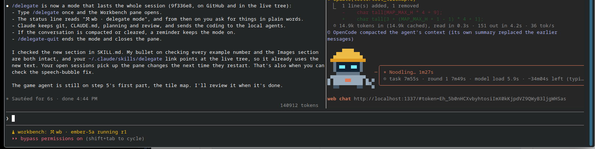
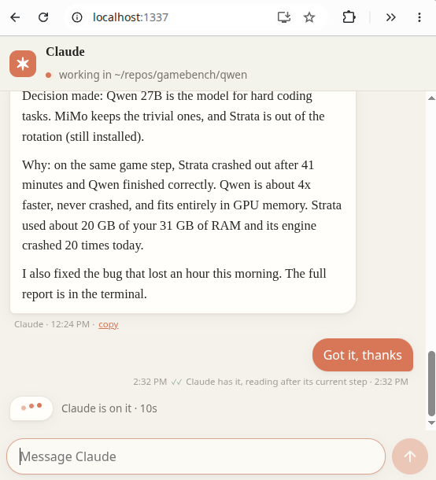

<p align="center"></p>

# Claude's Workbench

<p align="center">
<a href="https://github.com/a-schaefers/claudes-workbench/actions/workflows/check.yml"></a>
<a href="https://github.com/a-schaefers/claudes-workbench/actions/workflows/nightly.yml"></a>
<a href="https://github.com/a-schaefers/claudes-workbench/actions/workflows/opencode.yml"></a>
<a href="mod/.claude-plugin/plugin.json"></a>
<a href="https://code.claude.com/docs/en/plugins/mods/overview"></a>
<a href="#what-you-need"></a>
<a href="#what-you-need"></a>
<a href="#what-you-need"></a>
<a href="LICENSE"></a>
<a href="https://github.com/a-schaefers/claudes-workbench/commits/main"></a>
</p>

<p align="center"></p>

**Claude plans and reviews. Local models on your GPU write the code.**

**Who runs where**
- **Claude**, on Anthropic's servers (your subscription or API key): plans the work, writes a
  spec for each piece, reviews every diff, commits. It never runs on your GPU.
- **Your GPU**: the open coding models (through OpenCode and your model server) that do the coding itself:
  reading the code, editing files, running the tests, fixing what fails. Optionally, an image
  model too.

Claude's Workbench turns the local LLMs on your gaming PC into a crew led by a frontier model.
Open coding models you can run at home are strong enough to write real code, but left alone they
wander, overthink, cut corners, and drown in any task bigger than their small context. What they
lack isn't typing speed. It's an architect and a reviewer.

So Claude is both. It plans the project, breaks it into pieces a local model can finish, hands each
piece to the right model with the knowledge it needs, and reviews the result to its own standard
until it's right. Frontier compute goes where it counts, into planning, architecture and judgment;
the bulk of the tokens, the reading and writing and test-running, happen on your own hardware.

- **Claude architects the work.** It reads your codebase, decides the design, and writes a precise
  spec for every piece: the files to touch and the code to imitate, the exact names other code
  relies on, and a test that proves it's done.
- **Pieces sized to what your models actually finish.** A local model in a 32K context falls
  apart on an eight-file task and shines on a two-file one, so Claude cuts every project down to
  one concern per task, sized to the model that takes it, and runs the pieces in order. A step
  that never finished in an hour as one big task landed in half an hour as three small ones. The
  size isn't fixed: it scales with the context window your hardware serves (about two or three
  files and 150 lines on 32K, more on a bigger one), and every finished step corrects it, so a
  strong machine gets bigger tasks. The next piece in the same area goes to the same agent, which
  already knows the code.
- **A skill library that improves itself, with Claude holding the pen.** Every task leaves its
  lessons behind: each correction Claude sent back, what stopped the agent, what it had to ask,
  and what the agent itself says the next one would trip on. Claude is shown them when the task
  closes, and a correction that turns up in a second task stands out, because the next agent
  will get it wrong too. Claude turns lessons into skills, or patches the sentence in an existing
  skill that misled. Each agent gets only the skills that fit its task and gives them back when
  that part is done, so your local models get better at your work without retraining and without
  a cluttered prompt. Every skill is judged on outcomes: tasks that loaded it against tasks
  without it, and each edit on its own. Claude fixes or retires the ones that don't help. Skills
  from public libraries can seed it, but each is security-scanned and read by Claude first. The
  loop takes its cue from Nous Research's [Hermes Agent](https://github.com/NousResearch/hermes-agent),
  the self-improving agent. We kept its patch-first habit, its rules for what a lesson is and
  isn't, and its skill security scan (ported, MIT). We added what a single agent can't do for
  itself: a frontier model vetting every lesson, and an outcome record for each skill.
- **The right model for each piece.** Chores go to a small fast model, real work to the strongest
  one your GPU runs, and the choice learns from which model's work Claude actually accepts.
- **Held to a frontier standard.** Claude reads every diff itself, never takes the agent's word for
  it, and sends it back with exact notes until it's what Claude would have written, or fixes it or
  throws it out. "Good enough for a local model" is not a bar it accepts.
- **The cheap loop stays local.** Failing tests go back to the agent automatically. Claude only
  spends tokens on work that passes, a question the agent asks, or an agent that got stuck, and a
  live pane shows you both sides as they work.
- **Claude keeps the keys; the agents keep to the code.** Everything that shapes or ships the
  project stays with the more capable model: the architecture, every git write (commits, branches,
  merges, pushes, pull requests), CI/CD, deploys and infrastructure, and the project's `CLAUDE.md` /
  `AGENTS.md`, the instructions every agent reads. The agents write code, run the everyday tools
  of the work, write only inside their own worktree (plus the temp directory and build caches),
  and use git only to read. That's enforced, not just asked: a git write, an edit to those files,
  a command outside the everyday list or a write outside the worktree is refused, by the kernel
  on Linux with Landlock (`wb doctor` says whether yours has it). On macOS, and on Linux without
  it, only the direct forms are refused (OpenCode's rules and the read-only git shim): a
  guardrail there, not a wall. Two gaps, said plainly: the build caches and toolchain homes the
  lane leaves writable (so builds work without asking) can hold programs your own tools run later,
  outside it; and on WSL2 a Windows program runs outside it while interop is on (`wb doctor` says
  how to turn that off). When a task needs more, they ask Claude, and Claude grants it or does it.
- **Your repo stays yours.** Each agent works in its own git worktree, so your checkout is never
  touched, and nothing is committed (under your name, with no AI credit line) until Claude accepts
  it.
- **Still the Claude Code you know.** Claude stays the driver, in your own session, so everything
  you've set up keeps working: plugins and integrations like GitHub or Cloudflare, your skills,
  hooks and settings. Claude still opens the pull request, checks the deploy and files the issue
  the way it always has. Workbench only moves as much of the work as it can onto your hardware;
  the conveniences stay with Claude.

The payoff is a smaller Claude bill for the same quality bar: a cheaper subscription, or one day
just the API for the lead and local models for everything else. How much you save depends on how
much you use it and what your electricity costs (a busy GPU isn't free). But it's a fun project,
and it works.

## Quickstart

### What you need

- **[Claude Code](https://claude.com/claude-code)** 2.1.287 or newer (the pane is a Claude Code
  mod), with a Claude subscription or an API key
- **[OpenCode](https://opencode.ai)** 2.2.7 or newer (CI tests 2.3 and the newest release), which
  runs the local models as coding agents
- **A local model server**, any that speaks the OpenAI API: llama.cpp's `llama-server`, LM Studio,
  vLLM, Ollama and the like. Claude works with the one you already run. No server or models yet?
  That's fine: the first time you use it, Claude looks at your hardware, lays out the servers and
  models that fit it, and sets up the ones you pick in OpenCode (it asks before installing or
  downloading anything)
- Linux, macOS, or Windows through WSL2 (native Windows lacks the POSIX file locks and signals
  `wb` uses), with Python 3.11+ and git, which `wb` itself runs on
- **Optional, for images:** a local image tool and model ([Images](ARCHITECTURE.md#images)).
  Claude offers to set one up the first time a project needs a picture, and asks before
  installing or downloading anything

Whatever your machine, Claude picks models that fit it, and checks again every week as new ones
come out.

### Install

```sh
claude plugin marketplace add a-schaefers/claudes-workbench
claude plugin install workbench@workbench
~/.claude/plugins/marketplaces/workbench/bin/wb setup   # puts wb on your PATH and /workbench in your skills
wb doctor
```

Workbench checks for an update once a week and tells you; `/workbench-update` installs it (or
`wb update` in a terminal). Your state and skills stay as they are. Working on
Workbench itself? Install from a clone instead ([Installing](ARCHITECTURE.md#installing)).

### Use it

Open Claude Code in your project and type:

```
/workbench
```

The **Workbench** pane opens: workbench mode is on. Now use Claude like normal. Ask for what you
want in your own words, as often as you like; Claude just hands the coding to your local GPU
from now on, until you type `/workbench-quit`. (`/workbench add a high-score screen` turns it on
and starts on that in one go.)

Claude takes it from there:

1. The first time, it checks your hardware and your local models. If you have none, or better ones would fit your
   GPU, it recommends them and offers to set them up (it always asks before downloading).
2. It plans the work and splits it into small pieces a local model can finish.
3. It decides how hard each piece is and hands it to the right local model: chores (a rename, a
   config tweak, a small test) to a small fast model like MiMo 9B, real work (features,
   refactors, tricky bugs) to the strongest model your GPU runs, like Qwen 27B. Then it watches
   the agent work.
4. It reviews every change, sends it back with notes until it's right, and only then commits it.

The pane shows the agents working live. You talk to the driver, Claude,
on the left; Claude talks to the local agent, which does the work on the right:

<p align="center"></p>

Here Claude (left) has just sent the agent review feedback on a step: two exact changes, and
why. On the right the agent made them, built the project, ran the tests, and summed up its work;
the tests passed, so the task now says **done: waiting for Claude's review**, and Claude is woken
to read the diff.

| Command | What it does |
|---|---|
| `/workbench [task]` | turn on workbench mode for this session: the pane opens, and from then on Claude hands the coding of what you ask to your local models; run again, it brings the pane back |
| `/workbench-models` | check now which local models suit your hardware best (it also happens weekly) |
| `/workbench-update` | update Workbench now: `wb`, the skill and the pane (it checks weekly and tells you) |
| `/workbench-quit` | leave workbench mode: this session's agents stop now, their work is kept for later |
| `/workbench-quit-and-hand-back-claude` | leave workbench mode and have Claude finish this session's agents' tasks itself |

**Away from the computer?** `wb chat serve` runs a small web chat with the running Claude session,
and `wb chat url` prints its private link (on Linux, `systemctl --user link
"$PWD/systemd/wb-chat.service" && systemctl --user enable --now wb-chat`, run in the clone, keeps
it running, and `systemctl --user restart wb-chat` after an upgrade; it runs systemd's `python3`, so if yours comes from pyenv, uv or conda, the unit's comment says how to point it there; on macOS, a launchd agent running `~/.local/bin/wb chat serve` does). It's `http://localhost:1337`; to use it from your phone, reach your PC the way you
normally do and change the host in the link. It serves only localhost until you say otherwise in
`~/.config/workbench/chat.json`: `{"bind": ["localhost", "tailscale"]}` adds this machine's
Tailscale address, `{"bind": ["0.0.0.0"]}` every interface (your LAN, a VPN), and
`"hosts": ["chat.example.org"]` a name a tunnel or proxy sends (`"*"` for any).

<p align="center"></p>

**Watching from a terminal?** `wb watch` follows the newest task live, and `wb status` lists the
open ones.

<hr>

## How it works

The full account of every piece, what it does and why, is in [ARCHITECTURE.md](ARCHITECTURE.md).

## License

MIT.

<hr>

<p align="center"><a href="https://github.com/a-schaefers/backseat-driver"></a></p>

<p align="center"><b>Don't forget how to code.</b> <a href="https://github.com/a-schaefers/backseat-driver">Backseat Driver</a>
puts Claude in the back seat: you write every line, it watches, comments and answers.</p>
