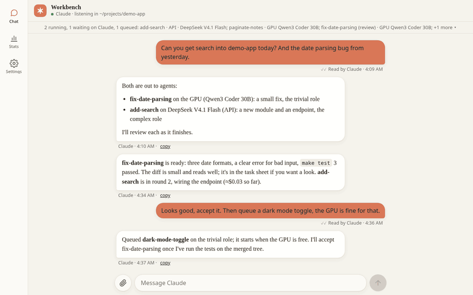
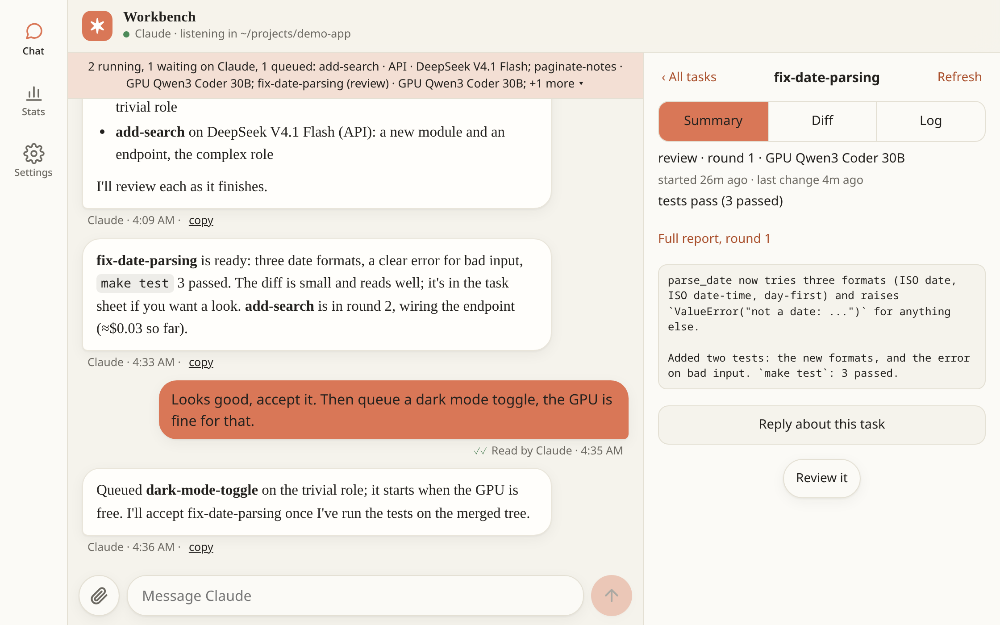
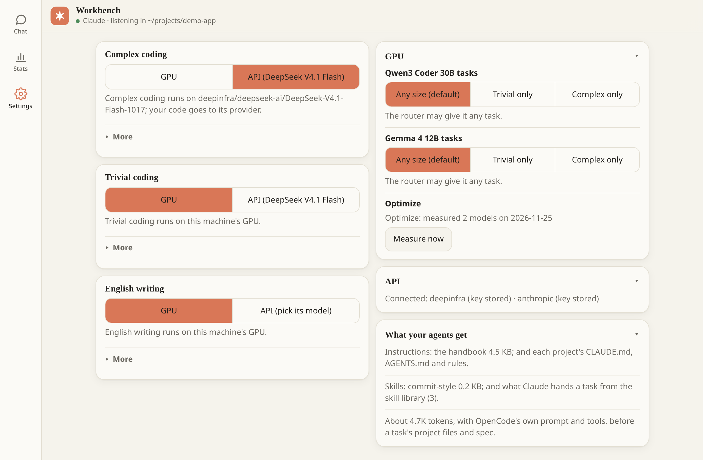
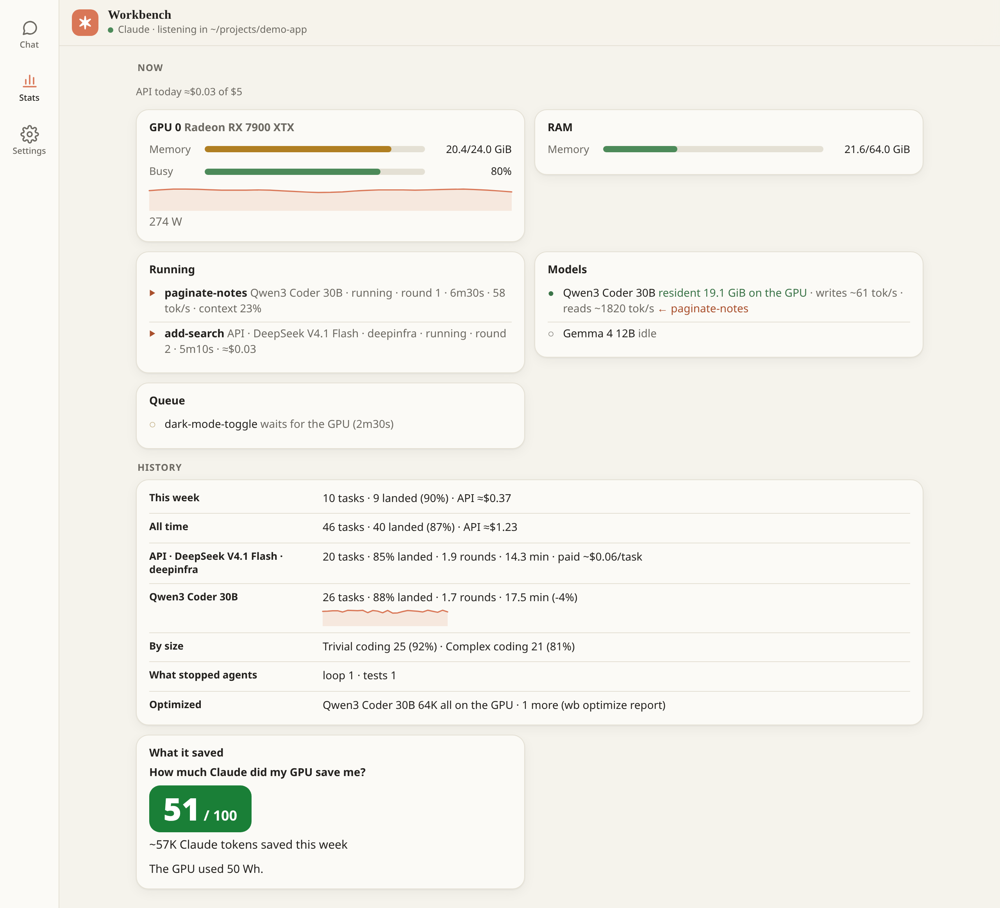

<p align="center"></p>

# Workbench

Workbench is a harness for OpenCode and Claude Code. An orchestrator agent plans and reviews the
work, and OpenCode subagents via API or GPU write the code.

<p align="center"><a href="https://github.com/sponsors/a-schaefers"></a></p>

<p align="center">
<a href="https://github.com/a-schaefers/workbench/actions/workflows/check.yml"></a>
<a href="https://github.com/a-schaefers/workbench/actions/workflows/nightly.yml"></a>
<a href="https://github.com/a-schaefers/workbench/actions/workflows/opencode.yml"></a>
<a href="https://github.com/a-schaefers/workbench/releases"></a>
<a href="#what-you-need"></a>
<a href="#what-you-need"></a>
<a href="LICENSE"></a>
<a href="https://github.com/a-schaefers/workbench/commits/main"></a>
</p>

```text
                                   ┌──────────┐
                                   │   YOU    │
                                   └────┬─────┘
                                        │ /workbench
                         ┌──────────────┴──────────────┐
                         │          pick one           │
                ┌────────▼─────────┐          ┌────────▼─────────┐
                │  Claude Code CLI │    OR    │   OpenCode CLI   │
                │   + the mod      │          │   + its plugin   │
                └────────┬─────────┘          └────────┬─────────┘
                         └──────────────┬──────────────┘
                                        ▼
 ┌──────────────────────────────────────────────────────────┐        ┌────────────────────┐
 │                     ORCHESTRATOR                         │◄──────►│   WEB APP  :8090   │
 │  first time? ─► setup questions                          │        │  tasks · stats ·   │
 │  plans · splits into steps · writes a test for each      │        │  settings · chat   │
 │  reviews each result · merges on your word               │        │  from any device   │
 └──────┬──────────────────────────────────────────▲────────┘        └────────────────────┘
        │ one step + its test                      │ report: review / stuck / failed
        ▼                                          │
 ┌──────────────┐   roles                          │
 │   router     │   significant ─► API, $5/day cap │
 │ size → model │   trivial ────► GPU              │
 └──────┬───────┘   writing ────► GPU              │
        ▼                                          │
 ┌─────────────────────────────────────────────────┴──────────────────────────┐
 │  runner (detached, one per task)                                           │
 │   GPU: lease + load model          API: provider slot + KEYHOLE (key here) │
 │  ┌──────────────── SANDBOX (Landlock / Seatbelt) ─────────────────────┐    │
 │  │  SUBAGENT (OpenCode) ─ writes code in its own worktree + branch    │    │
 │  │     git read-only · shell allowlist · no keys · ask_reviewer ──────┼────┼─► orchestrator
 │  │          │                                                         │    │
 │  │          ▼                                                         │    │
 │  │      run the test ── FAIL ──► error fed back, try again ──┐        │    │
 │  │          │              ▲                                 │        │    │
 │  │          │              └─────────────────────────────────┘        │    │
 │  │          ▼ PASS ─► self-review ─► green tree kept                  │    │
 │  └────────────────────────────────────────────────────────────────────┘    │
 │  guards: stuck detector · day cap · rate-limit pause · fresh session       │
 └────────────────────────────────────────────────────────────────────────────┘
        │ after your OK
        ▼
   commit on your branch (your name + a trailer naming the model)
        │
        ▼
   results ─► router · tuning · skill library ─► the next task's subagent does better
```

You describe a change to the orchestrator agent, which splits it into steps, writes a test for each
one, and hands each step to a subagent running the model you chose for it, on your GPU or an API.
Each subagent works on its own branch in a separate copy of the project. After each attempt the
step's test runs; if it fails, the subagent sees the error and tries again without involving the
orchestrator agent. When the test passes, the orchestrator agent reviews the change and reports to
you. Each step is sized to the model that writes it ([why](ARCHITECTURE.md#why-its-built-this-way)).

## What you need

- [OpenCode](https://opencode.ai) 2.3 or newer, even if you work in Claude Code, because the
  subagents run in it.
- Git 2.34 and Python 3.11 or newer, on Linux, macOS or WSL2.
- A model for the subagents: an API provider connected in `opencode` with `/connect`, or a local
  model with tool calls and a 32K context window (at least 16K). If you have neither, the
  orchestrator agent suggests a model for your GPU and can install Ollama and pull it for you.
- To use it in [Claude Code](https://claude.com/claude-code), a Claude subscription or an API key.

## Install

Install the plugin in one of:

### OpenCode Workbench: (CLI only)

```sh
opencode plugin add 'github:a-schaefers/workbench#main'
```

Open OpenCode in your project, pick the strongest model you have, local or API, for the orchestrator
agent in `/models`, and type `/workbench`. OpenCode keeps the plugin up to date.

### Claude Code Workbench: (CLI only)

```sh
claude plugin marketplace add a-schaefers/workbench
claude plugin install workbench@workbench
```

Open Claude Code in your project, choose the strongest Claude model for the orchestrator agent with
`/model`, and type `/workbench`.

## Using it

After `/workbench`, you get work done in two places. Talk to the orchestrator agent as you normally
would; the first time, it asks a few questions to set things up. Or open the web app at
`http://localhost:8090/#token=…`, linked from the Workbench panel, to chat with the orchestrator
agent, follow the subagents' tasks, see your stats and change settings.

<p align="center"></p>

<details>
<summary>More screenshots</summary>

<p></p>
<p></p>
<p></p>

</details>

## Models and cost

Workbench is free and open source. A task on your GPU uses its electricity, and your provider
bills the subagents' API use. The web app's Stats show what the week's tasks spent: the
orchestrator agent's tokens, the GPU's energy and the API dollars.

Workbench sorts the subagents' work into large steps, small steps and writing such as docs, and lets
you give each of these [roles](ARCHITECTURE.md#roles-which-model-a-kind-of-work-goes-to) its own
model. For example, large steps can go to an API model and the rest to your GPU.

On a GPU, Workbench [detects your hardware](ARCHITECTURE.md#models-found-loaded-chosen) and learns
from your results which local model suits each kind of work. Once a week it checks for better ones.
Ollama has the fullest support. Any OpenAI-compatible server [works
too](ARCHITECTURE.md#running-your-own-server), even one on another machine.

Any provider you have connected in OpenCode with an API key works for the subagents, as does a
GitHub Copilot sign-in. Their paid API usage counts against one daily [spending
cap](ARCHITECTURE.md#spend-what-an-api-task-costs) in dollars, across all providers.

## Safety and privacy

The subagents never touch your checkout, and their work is merged only after you accept it. Each
subagent runs in a [sandbox](ARCHITECTURE.md#what-the-agent-knows) that confines its writes to its
copy of the project and never lets it see your API key. It can run only listed commands, and git
only to read. The sandbox uses Landlock on Linux and Seatbelt on macOS. Workbench's code enforces
these limits and the spending cap.

Subagents on your own GPU don't send your code to any provider. A subagent on an API model sends
what it reads to that model's provider. The orchestrator agent sends what it reads to its own
model's provider, unless that model is local.

## What else it does

- Add the word `deepcode` to a request and the orchestrator agent runs several subagents in parallel
  that check each other's work, then judges what they produce. Workbench ships
  [flows](ARCHITECTURE.md#deep-workflows) for building, auditing, fixing and comparing attempts, and
  you can write your own.
- You can [schedule](ARCHITECTURE.md#scheduled-runs) work to run on a timer, even with OpenCode and
  Claude Code closed.
- Tasks run in the background, survive a restart of OpenCode or Claude Code, and [keep the machine
  from sleeping](ARCHITECTURE.md#kept-awake). After a reboot, ask the orchestrator agent to resume
  them.
- Accepted commits carry your name as author and a
  [trailer](ARCHITECTURE.md#git-commits-and-projects) naming the model that wrote the code.
- To reach the web app and its [chat](ARCHITECTURE.md#the-web-chat) from another device, point a
  tunnel or proxy you trust at it, or ask the orchestrator agent.
- When a review turns up a lesson, the orchestrator agent records it as a
  [skill](ARCHITECTURE.md#the-skill-library) and gives it to later subagents.
- The orchestrator agent can also direct local [image](ARCHITECTURE.md#images) and
  [audio](ARCHITECTURE.md#audio) models to make a project's icons, artwork, voice lines, sound
  effects and music.
- To have the orchestrator agent finish the subagents' open tasks itself when you quit, use
  `/workbench-quit-and-hand-back` (in Claude Code, `/workbench-quit-and-hand-back-claude`).

Every command, setting and file is described in [ARCHITECTURE.md](ARCHITECTURE.md).

## Contributing

Report bugs in the issue tracker. If you fix one yourself, Workbench keeps your fix across updates
and can send it upstream as a pull request, or as a .zip to email instead of using GitHub.
[CONTRIBUTING.md](CONTRIBUTING.md) shows how to set it up.

## License

MIT. Workbench is an independent project, not made by Anthropic or the OpenCode team.